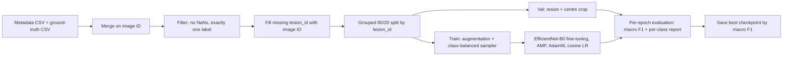

# Skin Lesion Classification on ISIC 2019 with EfficientNet-B0

A PyTorch pipeline that fine-tunes an ImageNet-pretrained **EfficientNet-B0** to classify dermoscopic images into **7 diagnostic categories** from the [ISIC 2019](https://challenge.isic-archive.com/landing/2019/) dataset. The project focuses on doing the evaluation *carefully*: lesion-level train/validation splitting to prevent data leakage, class-balanced sampling for a heavily imbalanced dataset, and macro-averaged metrics so that rare (and clinically important) classes are not hidden behind the majority class.

> **Disclaimer:** This is an educational / research project. It is **not** a medical device and must not be used for diagnosis or clinical decision-making.

---

## Table of contents

1. [Highlights](#highlights)
2. [Results](#results)
3. [Dataset](#dataset)
4. [Pipeline overview](#pipeline-overview)
5. [Methodology in detail](#methodology-in-detail)
6. [Configuration](#configuration)
7. [Getting started](#getting-started)
8. [Repository structure](#repository-structure)
9. [Reproducibility notes](#reproducibility-notes)
10. [Limitations](#limitations)
11. [Future work](#future-work)
12. [References](#references)
13. [Author and license](#author-and-license)

---

## Highlights

- **End-to-end pipeline** in a single, annotated notebook: data loading and merging, label construction, splitting, augmentation, training, per-epoch evaluation and checkpointing.
- **Leakage-aware splitting:** an 80/20 split grouped by `lesion_id` (`GroupShuffleSplit`), so that multiple images of the same lesion never appear in both training and validation sets.
- **Imbalance handling:** `WeightedRandomSampler` with inverse-frequency weights gives each mini-batch a roughly uniform class distribution. Model selection uses **macro F1** rather than accuracy.
- **Transfer learning:** all layers of an ImageNet-pretrained EfficientNet-B0 are fine-tuned, with the final linear layer replaced by a 7-way head.
- **Efficient training:** mixed-precision (AMP) training, AdamW optimiser, cosine learning-rate schedule, pinned memory and persistent data-loader workers.
- **Honest evaluation:** full per-class precision / recall / F1 reported at every epoch, with the limitations of the current evaluation protocol documented below.

---

## Results

All numbers below come from the **validation split** (4,228 images, grouped by lesion). The checkpoint (`best_model.pt`) is the epoch with the highest validation macro F1, so these figures are **optimistic** compared with performance on a truly untouched test set (see [Limitations](#limitations)).

### Overall

| Metric | Best epoch (epoch 17) | Final epoch (epoch 25) |
| --- | --- | --- |
| Macro F1 | **0.582** | 0.574 |
| Accuracy | 0.684 | 0.692 |
| Macro precision | 0.609 | 0.596 |
| Macro recall | 0.572 | 0.562 |

### Per-class performance at the best epoch (epoch 17)

| Class | Description | Precision | Recall | F1 | Support |
| --- | --- | --- | --- | --- | --- |
| AK | Actinic keratosis | 0.346 | 0.479 | 0.402 | 165 |
| BCC | Basal cell carcinoma | 0.653 | 0.727 | 0.688 | 601 |
| BKL | Benign keratosis-like lesion | 0.522 | 0.575 | 0.547 | 489 |
| DF | Dermatofibroma | 0.500 | 0.343 | 0.407 | 35 |
| MEL | Melanoma | 0.618 | 0.539 | 0.576 | 944 |
| NV | Melanocytic nevus | 0.809 | 0.797 | 0.803 | 1937 |
| VASC | Vascular lesion | 0.816 | 0.544 | 0.653 | 57 |
| | **Macro average** | 0.609 | 0.572 | 0.582 | 4228 |
| | **Weighted average** | 0.691 | 0.684 | 0.685 | 4228 |

### Reading the results

- **The majority class (NV) is the easiest**, with F1 around 0.80, despite oversampling.
- **Melanoma recall is only about 0.54.** Missing malignant lesions is the costly error in this domain, so recall on MEL (and BCC) matters more than overall accuracy.
- **Rare classes are the hardest.** DF has only 35 validation images, so its metrics are noisy: a handful of images changes recall by several points. VASC shows high precision but low recall.
- Validation macro F1 plateaus around 0.57 to 0.58 over the last ~10 epochs while training loss keeps falling (to roughly 0.29), which indicates the model has started to overfit the training set.

---

## Dataset

**ISIC 2019** is a public collection of dermoscopic skin lesion images assembled for the ISIC 2019 challenge. It combines images from the HAM10000 and BCN20000 datasets, among others. The training set contains 25,331 images across 8 diagnostic categories, with strong class imbalance (melanocytic nevi dominate).

### Inputs used in this project

| File | Purpose |
| --- | --- |
| `ISIC_2019_Training_GroundTruth.csv` | One-hot diagnostic labels per image |
| `metadata.csv` | Image IDs, lesion IDs and patient / lesion metadata |
| Preprocessed images (`step3_shadesofgray`) | Dermoscopic images after **shades-of-gray colour constancy** correction |

In the original Kaggle notebook these were read from the following inputs (adjust to your own location, see [Getting started](#getting-started)):

```text
/kaggle/input/isic-2019-prepocessed/step3_shadesofgray
/kaggle/input/d/demirelmas/metadata-csv/metadata.csv
/kaggle/input/isic-2019-training-groundtruth/ISIC_2019_Training_GroundTruth.csv
```

### Classes used

The model predicts **7 classes**: `AK`, `BCC`, `BKL`, `DF`, `MEL`, `NV`, `VASC`.

The SCC (squamous cell carcinoma) and UNK columns of ISIC 2019 are **not** part of the label set used here, so images whose only positive label is SCC are excluded by the single-label filter described below.

### Filtering

After merging metadata and labels on the image ID, the pipeline:

1. drops rows with any missing value (`dropna`), and
2. keeps only rows with **exactly one** positive label (to discard ambiguous annotations).

This leaves roughly 21,000 images in total (4,228 of them in the validation split).

---

## Pipeline overview



---

## Methodology in detail

### 1. Label construction

Labels are recovered from the one-hot columns with `idxmax(axis=1)` and mapped to integers using an alphabetically sorted class list, which gives a deterministic class ordering (`AK=0, BCC=1, BKL=2, DF=3, MEL=4, NV=5, VASC=6`). An `assert` checks that no label ended up as NaN after mapping.

### 2. Lesion-level grouped split

ISIC 2019 contains several images of the same physical lesion. A plain random split would put some of them in training and some in validation, so the model could be rewarded for recognising a lesion it has effectively already seen, which inflates validation scores.

To avoid this, images without a `lesion_id` fall back to their own image ID, and the data are split with `GroupShuffleSplit(n_splits=1, test_size=0.2, random_state=42)` using `lesion_id` as the group key. **All images of a lesion therefore land in the same split.**

### 3. Data augmentation and normalisation

| Stage | Transforms |
| --- | --- |
| Training | `RandomResizedCrop(224)`, `RandomHorizontalFlip()`, `ColorJitter(0.1, 0.1, 0.1, 0.05)`, `ToTensor()`, ImageNet normalisation |
| Validation | `Resize(256)`, `CenterCrop(224)`, `ToTensor()`, ImageNet normalisation |

Normalisation uses the ImageNet mean `[0.485, 0.456, 0.406]` and std `[0.229, 0.224, 0.225]`, matching the pretrained backbone. Validation transforms are deterministic so evaluation is reproducible.

### 4. Handling class imbalance

Class counts in the training split are inverted to give per-sample weights (`1 / class_count`), which feed a `WeightedRandomSampler` (`replacement=True`, `num_samples = len(train set)`). Rare-class images are therefore drawn many times per epoch, and each mini-batch sees a roughly uniform class distribution. The loss itself is plain (unweighted) cross-entropy; the rebalancing happens entirely in the sampler.

### 5. Model

- **Backbone:** `torchvision.models.efficientnet_b0` with `IMAGENET1K_V1` weights.
- **Head:** the final linear layer (`classifier[1]`) is replaced with `Linear(1280, 7)`. The default dropout (p=0.2) before it is kept.
- **Fine-tuning:** the backbone is **not frozen**; all layers are trained.
- EfficientNet-B0 was chosen because it offers strong accuracy at a small parameter count, which makes fine-tuning fast on a single GPU.

### 6. Optimisation

| Component | Choice | Rationale |
| --- | --- | --- |
| Loss | `CrossEntropyLoss` | Standard for multi-class classification on logits |
| Optimiser | `AdamW`, learning rate `3e-4` | Decoupled weight decay; reliable for fine-tuning |
| Schedule | `CosineAnnealingLR`, `T_max = 25` | Smooth decay of the learning rate to near zero over training |
| Precision | Automatic mixed precision (`autocast` + `GradScaler`) | Faster training and lower memory use on modern GPUs |

### 7. Evaluation and checkpointing

After every epoch the model is evaluated on the validation set. The script reports the full `classification_report` (per-class precision, recall, F1, support) and the **macro F1**, which weights all classes equally and is therefore a more informative selection metric than accuracy for an imbalanced problem. The weights are saved to `best_model.pt` whenever macro F1 improves.

---

## Configuration

All settings live in one cell near the top of the notebook:

| Parameter | Value | Notes |
| --- | --- | --- |
| `IMG_SIZE` | 224 | Native EfficientNet-B0 input size |
| `BATCH_SIZE` | 32 | Increase if you have more GPU memory |
| `EPOCHS` | 25 | One full cosine cycle |
| `LR` | 3e-4 | AdamW learning rate |
| `NUM_WORKERS` | 6 | Reduce to the number of CPU cores available (Kaggle suggested 4) |
| `IMG_DIR` | see [Dataset](#dataset) | Directory of colour-corrected images |
| Split | 80 / 20, `random_state=42` | Grouped by `lesion_id` |

---

## Getting started

### Requirements

- Python 3.11 (the version of the original Kaggle environment)
- A CUDA-capable GPU is strongly recommended (the code falls back to CPU, but training will be very slow)
- Packages:

```text
torch
torchvision
numpy
pandas
pillow
scikit-learn
jupyter
```

Install with:

```bash
pip install torch torchvision numpy pandas pillow scikit-learn jupyter
```

> Exact package versions of the original run were not pinned. If you want bit-for-bit environment parity, record yours with `pip freeze > requirements.txt` after a successful run.

### Option A: run on Kaggle (matches the original setup)

1. Create a Kaggle notebook and enable a GPU accelerator.
2. Add the three input datasets listed in [Dataset](#dataset).
3. Upload or paste `skin-cancer-detection.ipynb` and run all cells.
4. The best checkpoint is written to `best_model.pt` in the working directory.

### Option B: run locally

1. Download ISIC 2019 training images and ground truth from the [ISIC challenge page](https://challenge.isic-archive.com/landing/2019/), plus the metadata CSV.
2. (Optional but recommended to match the reported results) Apply shades-of-gray colour constancy to the images, or use the preprocessed Kaggle dataset.
3. Edit the paths in the notebook:

```python
IMG_DIR = "path/to/images"                                  # folder of <image_id>.jpg files
meta = pd.read_csv("path/to/metadata.csv")
gt   = pd.read_csv("path/to/ISIC_2019_Training_GroundTruth.csv")
```

4. Launch Jupyter and run all cells:

```bash
jupyter notebook skin-cancer-detection.ipynb
```

### Loading the trained model for inference

```python
import torch
import torch.nn as nn
from torchvision import models, transforms
from PIL import Image

classes = ["AK", "BCC", "BKL", "DF", "MEL", "NV", "VASC"]  # alphabetical, as in training

model = models.efficientnet_b0(weights=None)
model.classifier[1] = nn.Linear(model.classifier[1].in_features, len(classes))
model.load_state_dict(torch.load("best_model.pt", map_location="cpu"))
model.eval()

tfms = transforms.Compose([
    transforms.Resize(256),
    transforms.CenterCrop(224),
    transforms.ToTensor(),
    transforms.Normalize([0.485, 0.456, 0.406], [0.229, 0.224, 0.225]),
])

img = tfms(Image.open("example.jpg").convert("RGB")).unsqueeze(0)
with torch.no_grad():
    probs = torch.softmax(model(img), dim=1)[0]

for c, p in sorted(zip(classes, probs.tolist()), key=lambda t: -t[1]):
    print(f"{c}: {p:.3f}")
```

---

## Repository structure

```text
.
├── skin-cancer-detection.ipynb   # Annotated end-to-end notebook
├── README.md                     # This file
└── best_model.pt                 # Best checkpoint (generated by training; optional to commit)
```

---

## Reproducibility notes

What is controlled:

- The train/validation split is fixed (`GroupShuffleSplit`, `random_state=42`), so the same lesions are always in the same split given the same input files.
- Class ordering is deterministic (alphabetical).
- Validation preprocessing contains no randomness.

What is **not** fully controlled:

- No global seeds are set for PyTorch, NumPy or Python, and `torch.backends.cudnn.benchmark = True` is enabled for speed. Augmentation, the weighted sampler and weight updates are therefore **not bit-for-bit reproducible** across runs, and results will vary slightly.
- Results come from a **single training run**, so there are no confidence intervals or variance estimates.
- The notebook uses `torch.cuda.amp.autocast` and `torch.cuda.amp.GradScaler`, which are deprecated in newer PyTorch releases in favour of `torch.amp.autocast("cuda")` and `torch.amp.GradScaler("cuda")`. They still run but emit warnings.

For stricter reproducibility, add seeding at the top of the notebook:

```python
import random, numpy as np, torch
SEED = 42
random.seed(SEED); np.random.seed(SEED); torch.manual_seed(SEED); torch.cuda.manual_seed_all(SEED)
torch.backends.cudnn.benchmark = False
torch.backends.cudnn.deterministic = True
```

---

## Limitations

Being explicit about these matters more than the headline numbers:

1. **No separate test set.** The same validation split is used both to choose the best checkpoint and to report results, so reported scores are optimistically biased. A proper protocol would use a train / validation / test split (or cross-validation), with model selection on validation only.
2. **Seven of the dataset's classes only.** SCC and UNK are not modelled, and the `dropna` / single-label filters remove some images. Dropping rows with missing metadata (for example age, sex or anatomical site) may introduce selection bias, since missingness is not random.
3. **Limited metrics.** The notebook reports precision, recall, F1 and accuracy. It does **not** compute ROC-AUC, per-class AUC, a confusion matrix, or probability calibration.
4. **Single run, no variance estimate.** Differences of a few points in macro F1, and especially in small classes such as DF (n = 35) and VASC (n = 57), are within plausible run-to-run noise.
5. **Overfitting.** Training loss keeps decreasing while validation macro F1 plateaus after roughly epoch 15 to 17.
6. **Moderate absolute performance.** Melanoma recall of about 0.54 is far too low for any clinical use.
7. **Dataset bias.** ISIC data come from specific institutions, devices and (predominantly lighter-skinned) patient populations, so performance may not generalise to other settings or skin tones.
8. **Augmentation is minimal.** Only random resized crops, horizontal flips and mild colour jitter are used.

---

## Future work

- Add a **held-out test split** and report final metrics on it only once.
- Report **one-vs-rest ROC-AUC (per class and macro)**, **confusion matrices** and **calibration curves**. A starting point:

```python
import numpy as np, torch
from sklearn.metrics import roc_auc_score, confusion_matrix

model.eval()
all_probs, all_targets = [], []
with torch.no_grad():
    for x, y in val_loader:               # use the test loader for final numbers
        p = torch.softmax(model(x.to(DEVICE)), dim=1).cpu().numpy()
        all_probs.append(p); all_targets.append(y.numpy())

probs = np.concatenate(all_probs)
targets = np.concatenate(all_targets)

macro_auc = roc_auc_score(targets, probs, multi_class="ovr", average="macro")
cm = confusion_matrix(targets, probs.argmax(1))
print(f"Macro one-vs-rest ROC-AUC: {macro_auc:.3f}")
print(cm)
```

- Compare **loss-based imbalance handling** (class-weighted cross-entropy, focal loss) against sampler-based oversampling, and test combining them.
- Try **stronger augmentation** (rotations, vertical flips, CutMix / MixUp) and **larger backbones or higher resolutions** (EfficientNet-B3 or above).
- Include the **SCC** class and handle **UNK** explicitly (for example as out-of-distribution detection).
- Use the available **patient metadata** (age, sex, anatomical site) in a multimodal model.
- Run **multiple seeds or k-fold grouped cross-validation** and report mean and standard deviation.
- Add **explainability** (Grad-CAM) to check whether the model attends to the lesion itself rather than artefacts such as rulers, ink marks or vignettes.
- Tune decision thresholds for **high sensitivity on melanoma**, and report sensitivity at fixed specificity.

---

## References

- Tschandl, P., Rosendahl, C., Kittler, H. *The HAM10000 dataset, a large collection of multi-source dermatoscopic images of common pigmented skin lesions.* Scientific Data 5, 180161 (2018).
- Codella, N. et al. *Skin Lesion Analysis Toward Melanoma Detection 2018: A Challenge Hosted by the International Skin Imaging Collaboration (ISIC).* arXiv:1902.03368 (2019).
- Combalia, M. et al. *BCN20000: Dermoscopic Lesions in the Wild.* arXiv:1908.02288 (2019).
- Tan, M., Le, Q. *EfficientNet: Rethinking Model Scaling for Convolutional Neural Networks.* ICML (2019).
- Loshchilov, I., Hutter, F. *Decoupled Weight Decay Regularization.* ICLR (2019).
- Finlayson, G., Trezzo, E. *Shades of Gray and Colour Constancy.* Color and Imaging Conference (2004).
- ISIC 2019 challenge: https://challenge.isic-archive.com/landing/2019/

---

## Author and license

**Rares Ioan Costinescu**
[GitHub](https://github.com/rarescos) · [LinkedIn](ADD-LINK-HERE)

Released under the **[CHOOSE A LICENSE, e.g. MIT]** license (add a `LICENSE` file to the repository).

The ISIC 2019 data are subject to their own licence and terms of use (check the ISIC archive and the dataset pages above before redistributing any images or derived data).